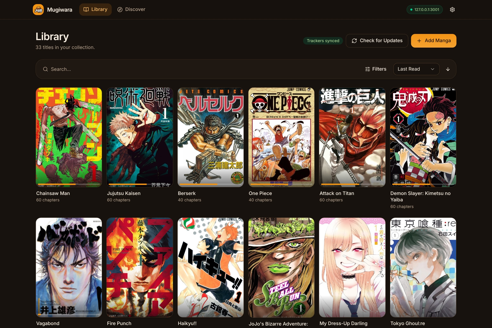

# Mugiwara

<p align="center">
  
</p>

<p align="center">
  
</p>

<p align="center">
  <em>The same library, on your desktop, phone and browser.</em>
</p>

Mugiwara is a self-hosted manga reader. One shared web client runs in a browser,
inside the Electron desktop shell, and inside the Capacitor mobile shell. A
single Node server owns the library, files, plugins, download queue and SQLite
database.

- **Self-hosted and local-first** — your library, progress and credentials stay
  on your machine or LAN.
- **One UI everywhere** — desktop, mobile and web use the same React app; there
  is no per-platform fork.
- **Bring your own sources** — built-in local-filesystem support plus a
  plugin API for source and storage backends.
- **Reads the way you want** — RTL, vertical, webtoon and paged modes, themes,
  progress tracking, categories and filters.
- **Tracker friendly** — optional two-way sync with AniList and MyAnimeList.

## Quick start

```sh
pnpm install
pnpm dev
```

This starts the API on `:3001`, the web client on `:5173` and the Electron
window. To run Mugiwara for the whole LAN, build the client and server, then run
the server on the machine that holds the library:

```sh
pnpm --filter @mugiwara-manga/web build
pnpm --filter @mugiwara-manga/server build
PORT=3001 DATA_DIR=/path/to/mugiwara-data node apps/server/dist/index.js
```

Open the printed LAN URL from any device and pair it with the one-time code in
the server log. See [Getting started](docs/getting-started.md) for prerequisites,
development workflows and LAN setup.

## Documentation

| Guide                                                 | What it covers                                                    |
| ----------------------------------------------------- | ----------------------------------------------------------------- |
| [Getting started](docs/getting-started.md)            | Prerequisites, development commands, LAN deployment               |
| [Architecture](docs/architecture.md)                  | Repository layout, server/web/desktop/mobile boundaries           |
| [Authentication and security](docs/authentication.md) | Pairing, tokens, environment variables, CORS/CSRF and rate limits |
| [Library and progress](docs/library.md)               | Reading status, progress sync and filter semantics                |
| [Plugins](docs/plugins.md)                            | Source/storage plugins and install hardening                      |
| [UI system](docs/ui.md)                               | Themes, routing, shadcn/Tailwind conventions                      |
| [Desktop](docs/desktop.md)                            | Electron development, packaging and LAN-server mode               |
| [Mobile](docs/mobile.md)                              | Capacitor setup, Android APKs and iOS builds                      |
| [Tracker sync](docs/tracking.md)                      | AniList/MyAnimeList configuration and conflict handling           |
| [Branding](docs/branding.md)                          | Logo master and generated platform assets                         |
| [Development](docs/development.md)                    | Tests, gating checks, build and release commands                  |
| [Documentation index](docs/README.md)                 | All guides in one place                                           |

## Contributing

Contributions are welcome. Read [CONTRIBUTING.md](CONTRIBUTING.md) before opening
a pull request, and run `pnpm verify` before you push.

## License

Mugiwara is free software licensed under the
[GNU General Public License v3.0 or later](LICENSE) (`GPL-3.0-or-later`).
You may redistribute it and/or modify it under the terms of the GPL. There is
no warranty, to the extent permitted by law.
